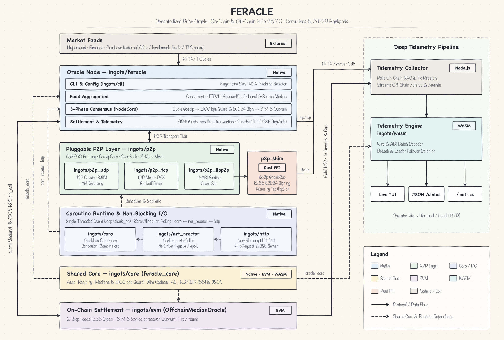
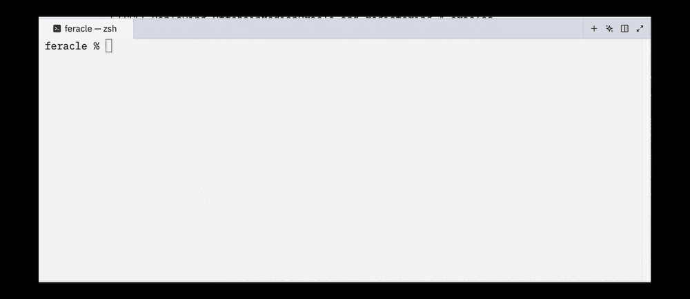
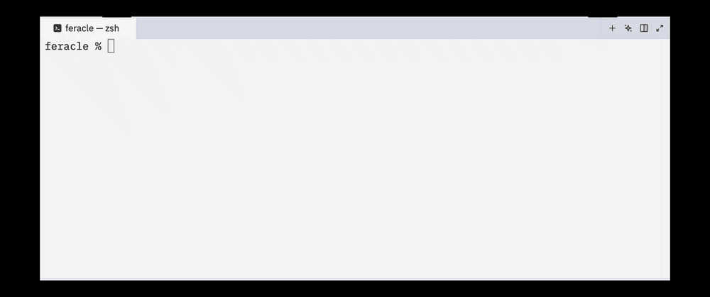
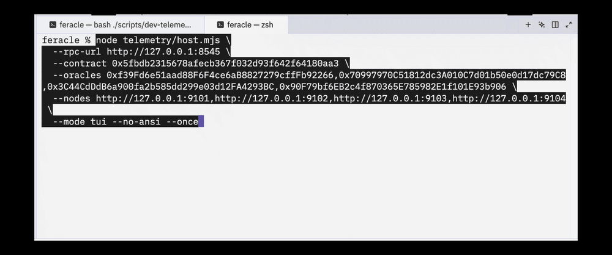
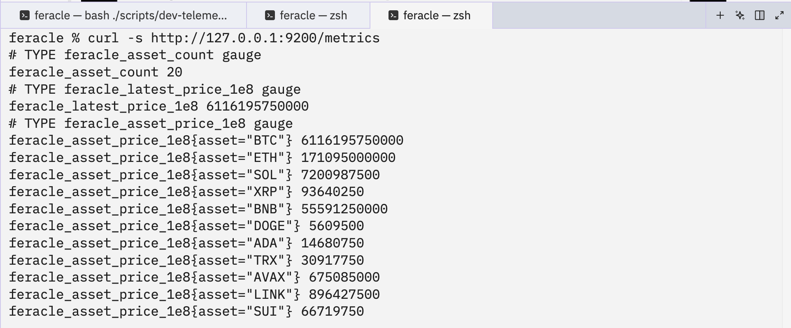

# Feracle

Feracle is a decentralized price oracle with both on-chain settlement and off-chain consensus facilities built end-to-end in **Fe**. A single target-independent core compiles across Native, EVM, and WASM targets, powering an off-chain node runtime with three selectable peer-to-peer networking backends (`libp2p` GossipSub, TCP mesh with PEX, and UDP SWIM gossip).


> [!IMPORTANT]
> Feracle is experimental, unaudited software. It intentionally omits many safeguards required in a production decentralized oracle network—such as staking/slashing, Sybil-resistant membership, HSM key management, and governance fail-safes—and should not be used in production with real funds.

## The problem

Decentralized price oracles split their stack across different toolchains—Solidity on-chain, Go or Rust off-chain, and TypeScript for monitoring. Protocol engineers and oracle operators end up re-implementing ABI framing, fixed-point math, and tolerance checks in three languages, creating silent parity bugs and heavy operational glue.

## Approach

Feracle unifies the entire oracle pipeline around one shared core and three selectable peer-to-peer networking backends:

- **Shared core ([`feracle_core`](ingots/core/README.md)):** Fixed-point medians, `±100 bps` tolerance checks, ABI selectors, EIP-1559/EIP-155 RLP codecs, and signed `QuoteMsg`/`SigMsg` wire codecs compile identically to Native, EVM, and WASM.
- **On-chain settlement ([`evm`](ingots/evm/README.md)):** `OffchainMedianOracle` verifies `QUORUM = 3` strictly sorted canonical (EIP-2 low-`s`) `ecrecover` signatures over a two-step batch digest, stores 20 prices packed `4×u64` across 5 storage slots, emits `MediansSubmitted` events, provides two-step ownership transfer (`transferOwnership` / `acceptOwnership`), emergency `pause` / `unpause`, and exposes Chainlink-compatible `latestRoundData()` and `decimals()`.
- **Off-chain consensus (`feracle`) & P2P backends ([`p2p`](ingots/p2p/README.md), [`p2p_udp`](ingots/p2p_udp/README.md), [`p2p_tcp`](ingots/p2p_tcp/README.md), `p2p_libp2p`):** Nodes aggregate exchange quotes over HTTP/1.1, run a 3-phase consensus protocol (authenticated `feracle-quote-v1` quote gossip → `±100 bps` guard & ECDSA batch signing → `3-of-N` quorum with `round_id % NODE_COUNT` leader rotation, quorum grace, backup failover, and EIP-1559 type-2 transaction submission with fee-bumped replacement), and swap transports cleanly behind `p2p::P2pEngine` (`uses E`) and `p2p::Transport`.
- **Deep telemetry ([`wasm`](ingots/wasm/README.md)):** Every oracle node exposes a unified pure-Fe HTTP/SSE telemetry endpoint (`/status` and `/events`) across `libp2p`, `tcp`, and `udp`. `telemetry/host.mjs` indexes `MediansSubmitted` logs via `eth_getLogs` and feeds a standalone WASM engine rendering a live TUI, JSON snapshots, and Prometheus metrics.

## Fe highlight

Fe's **associated effect polymorphism (`uses E`)** and **scoped capability injection (`with (...)`)** are what made it possible to build a single-threaded, non-blocking oracle runtime across three interchangeable P2P transports—and deterministically unit-test its 3-phase consensus state machine—without a hidden async executor, heap-boxed futures, or global state.

In [`ingots/coro/`](ingots/coro/README.md) and [`ingots/p2p/`](ingots/p2p/README.md), traits declare an abstract effect row (`uses E`), combinators like `Join2` and `block_on` compose effects statically at compile time, and each driver or P2P backend requests *only* the capabilities it actually touches:

```fe
// ingots/coro/src/task.fe & combinators.fe — stackless concurrency with effect rows
pub trait Coroutine {
    type Output
    uses E
    fn poll(mut self) -> Poll<Self::Output> uses E
}

impl<A: Coroutine, B: Coroutine> Coroutine for Join2<A, B> {
    type Output = (A::Output, B::Output)
    uses E = (A::E, B::E) // composed tasks union their effects statically
    // ...
}

pub fn block_on<C: Coroutine, D: Driver>(_ coro: mut C, _ driver: mut D) -> C::Output
uses (C::E, D::E) {
    // ...
}

// Each driver & P2P backend declares only what it actually touches (methods elided):
impl Driver for NetDriver          { uses E = (clock: Clock, sched: mut Scheduler, io: mut SocketIo) }
impl Driver for VirtualClockDriver { uses E = (sched: mut Scheduler) }

impl P2pEngine for Libp2pTransport { uses E = (io: mut SocketIo) }
impl P2pEngine for UdpEngine       { uses E = (sched: mut Scheduler, io: mut SocketIo) }
impl P2pEngine for TcpEngine       { uses E = (net: mut Net, sched: mut Scheduler, io: mut SocketIo) }

// Production (ingots/feracle/src/main.fe) binds kqueue/epoll + secp256k1:
with (Scheduler = sched, SocketIo = io, Crypto = native_crypto) {
    // ...
    block_on(mut node, mut driver)
}

// Deterministic tests (ingots/feracle/src/test_consensus.fe) swap in virtual time + scripted I/O:
with (Crypto = mock, Scheduler = sched, SocketIo = io) {
    var cons = ConsensusCoro::new(config: cfg)
    // ...
}
```

The same explicit capability model extends straight down to the EVM settlement contract ([`ingots/evm/src/lib.fe`](ingots/evm/src/lib.fe))—where `SubmitMedians` declares `uses (ctx, mut store, mut log)`, `LatestPrices` declares read-only `uses (store)`, and `Decimals` is statically pure—and to the WASM telemetry exports (`uses (clock: mut Clock)`).

## Features

- **Cross-target shared core:** One pure-Fe library (`feracle_core`) compiles identically to Native, EVM, and WASM for fixed-point medians, tolerance math, wire codecs, ABI, and EIP-1559/EIP-155 RLP.
- **Fault-tolerant 3-of-N consensus:** Authenticated `QuoteMsg` gossip, local 3-exchange medians with a `±100 bps` cross-node guard, `QUORUM = 3` over 4 oracles, and `round_id % NODE_COUNT` leader rotation with backup failover (1 tx/round).
- **Gas-packed EVM settlement:** `OffchainMedianOracle` packs 20 prices `4×u64` across 5 slots (~78.4k warm gas), enforces EIP-2 canonical `ecrecover` quorums, and exposes `latestRoundData()`, two-step ownership, and pause controls.
- **Pluggable P2P & non-blocking I/O:** Swap `libp2p` GossipSub (wakeup fd), pure-Fe TCP (PEX), or pure-Fe UDP (SWIM) behind `P2pEngine` (`uses E`) on a single-threaded `coro` + `net_reactor` event loop with EIP-1559 fee-bumped submission.
- **Unified HTTP/SSE & WASM telemetry:** Every node serves `/status` and `/events` across all transports into a `telemetry_wasm` engine indexed via `eth_getLogs`, rendering a live TUI, JSON snapshots, and Prometheus `/metrics`.

## Architecture



https://github.com/user-attachments/assets/671074da-eee6-465b-aa1b-f057559ce45c

### Off-Chain Node & Networking (`[Native]`)

1. **`ingots/feracle/`** — Standalone oracle node executable (`out/feracle`):
   - Parses CLI configuration (`--p2p-backend libp2p|tcp|udp`, `--lan-discovery-port`, `--telemetry-port`) with `FERACLE_*` environment fallbacks (`FERACLE_PRIVKEY_HEX` recommended over `--privkey-hex`) and handles `SIGINT`/`SIGTERM` cleanly through a signal wakeup fd.
   - Fetches market quotes concurrently over non-blocking HTTP/1.1 (`http::HttpRequest` + `coro::Timeout` + `coro::BoundedPool` sliding-window fan-out and retry backoff for Coinbase) from Hyperliquid, Binance, and Coinbase and computes per-asset local medians.
   - Executes the 3-phase stackless coroutine state machine (`ConsensusCoro`, driven by `NodeCoro` + `coro::block_on` with injectable `Crypto` and `PeerMesh` capabilities) over `coro::Scheduler` and `net_reactor::SocketIo`: authenticated `QuoteMsg` gossip (verified off-chain across all transports) → per-asset `±100 bps` tolerance guard and ECDSA signing → sorted `3-of-N` quorum collection (`QUORUM = 3` across `NODE_COUNT = 4`) and leader-rotated batch submission (`round_id % NODE_COUNT`) via EIP-1559 type-2 raw tx (`eth_feeHistory` + bumped replacement tx on receipt timeout, falling back to legacy EIP-155).
   - Reads on-chain `currentRound()` and `latestPrices()` via `QueryRoundState` / `QueryCurrentRound` (`coro::Join2`) and serves unified pure-Fe HTTP/SSE telemetry (`/status` and `/events`) over `http::HttpServer` across all three transports (`libp2p`, `tcp`, and `udp`).
2. **[`ingots/coro/`](ingots/coro/README.md)** — Cooperative, single-threaded stackless coroutine & combinator library:
   - Defines `Coroutine` (`uses E`), `Driver`, `Poll<T>`, `Either<A, B>`, `Scheduler` (`LocalScheduler`, `VirtualClockDriver`), and `block_on`, plus composable combinators (`Sleep`, `Timeout`, `Ready`, `YieldOnce`, `Map`, `Join2`, `Select2`, `JoinAll`, `BoundedPool`).
   - Keeps state-machine timing and concurrency decoupled from I/O (paired with `net_reactor` for native event loops and `VirtualClockDriver` for deterministic tests).
3. **[`ingots/net_reactor/`](ingots/net_reactor/README.md)** — Native OS socket multiplexing & `coro::Driver` bridge:
   - Exposes `SocketIo` (`NetPoller` backed by `std::net::Poller`, reusable `Events` scratch storage, coalesced `IoEvent` delivery, and `register_raw_fd` for external/signal wake fds) and `NetDriver` (`impl coro::Driver`) synchronizing wall-clock time to `coro::Scheduler`.
4. **[`ingots/http/`](ingots/http/README.md)** — Consumer-agnostic non-blocking HTTP/1.1 client & server:
   - Provides `HttpRequest` (`impl coro::Coroutine`, chunked transfer decoding, `HttpRequest::start_with_timeout`) and generic `HttpServer` (`HttpEvent`, SSE upgrade, keepalive, backpressure lag detection) driven via `Scheduler` + `SocketIo`.
5. **[`ingots/cli/`](ingots/cli/README.md)** — Standalone, effect-polymorphic CLI parser and runner:
   - `Input` / `Output` effect traits (`Args`/`Env`/`Stdout`/`Stderr` in host mode; deterministic `MemoryInput`/`BufferOutput` in unit tests).
   - Capability injection via `with (Cli = matches)` and `FromArg` return-type inference for primitives, network addresses, and domain types.
   - GNU/POSIX option parsing, env/default precedence, repeatable/delimited values, recursive subcommands, Levenshtein typo suggestions, sensitive-value redaction, `.arg_required_else_help()`, and `--help` / `--version`.
6. **[`ingots/p2p/`](ingots/p2p/README.md)** — Shared P2P engine and transport contract:
   - Common self-delimiting binary envelope (`0xFE50` magic, `version`, `kind`, `(origin, seq)` identity, mutable hop `ttl`, `len <= 1200`), effect-polymorphic `P2pEngine` (`uses E`), and `Transport` trait (`publish`, `poll`, `recv`, `peer_count`, `peer_entries`, `stats`, `add_seed`).
   - Shared `GossipCore` state, bounded ring `SeenCache`, bounded FIFO `Inbox`, `PeerBook` (direct `observe` vs gossip `learn`, suspicion & expiry), `PeerEntry` wire codecs with `0.0.0.0` normalization, timers/backoff, fanout selection, and seed parsing (`ip:port` or `/ip4/<ip>/(tcp|udp)/<port>`).
7. **[`ingots/p2p_udp/`](ingots/p2p_udp/README.md)** — Connectionless UDP gossip + SWIM membership backend (`UdpEngine` using `Scheduler` + `SocketIo` capabilities + `UdpTransport` wrapper):
   - Non-blocking `UdpSocket` I/O under `SocketIo` (`kqueue`/`epoll`), TTL-decrementing gossip forwarding, SWIM failure detection (`JOIN`/`PING`/`PING_REQ`/`Suspect` expiry), and optional UDP broadcast LAN discovery.
8. **[`ingots/p2p_tcp/`](ingots/p2p_tcp/README.md)** — Non-blocking TCP mesh + Peer Exchange backend (`TcpEngine` using `Scheduler` + `SocketIo` capabilities + `TcpTransport` wrapper):
   - `TcpListener`/`TcpStream` interest management under `SocketIo`, partial read/write framing, PEX peer discovery, deterministic simultaneous-dial tie-breaking, exponential backoff dialing, and `PING`/`PONG` keepalives.
9. **`ingots/p2p_libp2p/`** — `libp2p` GossipSub binding (`Libp2pTransport` implementing `p2p::P2pEngine` and `p2p::Transport`):
   - Isolates the `p2p_*` C-ABI FFI surface behind opaque handle IDs and registers the shim's wakeup pipe fd in `net_reactor` via `register_raw_fd`, avoiding periodic polling floors.
10. **`p2p-shim/`** (`[Rust staticlib]`) — Panic-safe C ABI (`libp2p_shim.a`):
    - Opaque handle registry for `libp2p` GossipSub (`"fe-oracle/top20-usd/v1"`) over TCP + Noise + Yamux + mDNS with an event-driven wake pipe for `NetPoller`.
    - `crypto_keccak_and_sign`, `crypto_keccak_and_sign_bytes`, and `crypto_verify_keccak_bytes_sig` (`tiny-keccak` + `k256`) for quorum batch signatures, raw EIP-1559/EIP-155 tx signing, and off-chain `feracle-quote-v1` quote authentication.
    - Process-wide `SIGINT`/`SIGTERM` atomic flag + signal wake pipe for clean node teardown.

### Shared Core & On-Chain Settlement (`[Native / EVM / WASM]`, `[EVM]`)

11. **[`ingots/core/`](ingots/core/README.md) (`feracle_core`)** (`[Shared Core: Native / EVM / WASM]`) — Target-independent library shared by all on-chain and off-chain targets (named `feracle_core` so it does not shadow Fe's builtin `core` ingot):
    - Default 20-asset registry (`ASSET_COUNT = 20`: `BTC`..`AAVE`, scaled by `1e8`, `NODE_COUNT = 4`, `QUORUM = 3`).
    - Median helpers (`median_of_three`, `median_of_four`), `u128`-safe integer `within_tolerance_bps` checks, float-free `parse_decimal_1e8`, hex/JSON/ABI codecs, EIP-1559 (`0x02`) & legacy EIP-155 RLP tx encoders + `eth_feeHistory` parser, and canonical 262-byte `QuoteMsg` (`0x00`) / `SigMsg` (`0x01`) wire codecs with `feracle-quote-v1` domain preimages.
    - Round-leader rotation (`round_id % NODE_COUNT`), address comparators, and deterministic `QUORUM`-signature sorting.
12. **[`ingots/evm/`](ingots/evm/README.md)** (`[EVM]`) — `OffchainMedianOracle` settlement contract:
    - Packs the 20 latest `u64` prices `4`-per-word across 5 storage slots (`MAX_PRICE_U64`), and tracks `owner`, `pending_owner`, `paused`, `is_oracle`, `current_round`, and `last_updated`.
    - Verifies the 2-step batch digest (`keccak256(abi.encode(chain_id, address(this), round_id, keccak256(abi.encode(prices)), timestamp))`) and recovers `QUORUM = 3` strictly ascending unique authorized signers via EIP-2 low-`s` `ecrecover`.
    - Exposes `submitMedians`, `addOracle`/`removeOracle`, `transferOwnership`/`acceptOwnership`, `pause`/`unpause`, `latestRoundData()` + `decimals()`, `latestPrices()`, `latestPrice(uint256)`, `assetCount()`, `currentRound()`, `isOracle(address)`, `owner()`, `pendingOwner()`, and `paused()`, plus `MediansSubmitted` and governance events.

### Deep Telemetry & Local Tooling (`[WASM]`, `[Node.js]`, `[Python / Caddy]`)

13. **[`ingots/wasm/`](ingots/wasm/README.md) & `telemetry/host.mjs`** (`[WASM]` + `[Node.js]` host):
    - `ingots/wasm/` (`telemetry_wasm`) resolves handles via `resolve_engine`, reuses `feracle_core` to decode JSON-RPC batches and 21-word `latestPrices()` responses, parse off-chain `QuoteMsg`/`SigMsg` frames, flag leader failovers and `>100 bps` per-asset breaches, and render a live TUI, JSON snapshot, and Prometheus metrics.
    - `telemetry/host.mjs` indexes `MediansSubmitted` settlements via `eth_getLogs` (with bounded LRU caches), consumes unified HTTP `/status` + SSE `/events` across all 3 transports (skipping redundant `/status` polls while SSE is fresh), feeds `out/telemetry_wasm.wasm`, and serves `/status` and `/metrics` via `--metrics-port`.
14. **`infra/` & `scripts/`**:
    - `infra/Caddyfile`: Default loopback TLS reverse proxy (`127.0.0.1:9001`–`:9003`) forwarding live Hyperliquid, Binance (`data-api.binance.vision`), and Coinbase feeds for `feracle-demo` and `scripts/dev-telemetry.sh`.
    - `infra/mock_feeds.py` (`[Python 3]`): Deterministic local mock HTTP servers used for `--mock-feeds` offline runs and E2E outlier fault-injection suites (with `--outlier-port`).
    - `scripts/ensure-deps.sh`, `scripts/install.sh`, `scripts/build-feracle.sh`, `scripts/build-wasm.sh`, `scripts/e2e.sh`, `scripts/e2e-telemetry.sh`, `scripts/dev-telemetry.sh`.

#### Caddy TLS proxy trade-offs

Because `ingots/http` implements pure-Fe non-blocking HTTP/1.1 directly over `std::net::TcpStream` without native TLS yet, `feracle-demo` and `scripts/dev-telemetry.sh` terminate upstream exchange HTTPS (`api.hyperliquid.xyz`, `data-api.binance.vision`, `api.exchange.coinbase.com`) in a local Caddy sidecar (`infra/Caddyfile`) listening on plaintext `127.0.0.1:9001`–`:9003`:

- **Upsides:** Keeps the `out/feracle` binary small with zero OpenSSL/Rustls links inside Fe's HTTP ingot, allows direct local mock replacement (`infra/mock_feeds.py`) on identical `ip:port` endpoints, and makes wire HTTP traffic trivially inspectable during local debugging.
- **Trade-offs:** Operators running against live HTTPS feeds must run Caddy (or an equivalent loopback TLS terminator) alongside the node, trust the local loopback boundary between `feracle` and the proxy, and rely on Caddy for upstream TLS verification and `Host` header rewriting. Production deployments without a trusted host/pod sidecar would require adding TLS termination at the socket layer.

## Quickstart (Prebuilt Binaries)

Install `feracle`, `feracle-telemetry`, and the local devnet launcher (`feracle-demo`) into `~/.local/bin` (downloads the release archive for `linux-x86_64`, `linux-arm64`, or `darwin-arm64`, or falls back to building from source). Missing runtime dependencies (`anvil`/`cast`, `Node.js >= 20`, `caddy`) are installed automatically on first run or upfront with `--install-deps`:

```bash
curl -fsSL https://raw.githubusercontent.com/highestagent/feracle/main/scripts/install.sh | bash
```

Optional installer flags: `--prefix <DIR>`, `--version <TAG>`, `--archive <PATH>` (install a CI artifact tarball), `--install-foundry`, and `--install-deps`. Ensure `~/.local/bin` is on your `PATH`, then run:

```bash
feracle                      # print node CLI options (or pass flags to run)
feracle-telemetry --help     # WASM telemetry collector options
feracle-demo                 # local Anvil + 4 nodes + Caddy live feeds + telemetry TUI
feracle-demo --backend udp   # switch P2P transport (libp2p | tcp | udp)
feracle-demo --mock-feeds    # run offline with deterministic mock_feeds.py
```

## Build & Test

**Prerequisites:** Missing dependencies (`fe`, Rust `cargo`, Foundry, `Node.js >= 20`, `caddy`) are installed automatically when needed by `scripts/install.sh`, `feracle-demo`, `scripts/dev-telemetry.sh`, `scripts/e2e.sh`, and `scripts/e2e-telemetry.sh` (or via `scripts/ensure-deps.sh`). `python3` is only needed for `--mock-feeds` or the E2E suites.

### Build from source

Clone and install to `~/.local/bin`, or build artifacts in-place under `out/` and `ingots/evm/out/`:

```bash
git clone https://github.com/highestagent/feracle.git && cd feracle

# Option A: build and install wrappers to ~/.local/bin
./scripts/install.sh --from-source

# Option B: build artifacts in-place and run directly
fe build --emit abi,bytecode --out-dir ingots/evm/out ingots/evm
./scripts/build-wasm.sh
./scripts/build-feracle.sh

./out/feracle                   # native oracle node (prints CLI help with no args)
node telemetry/host.mjs --help  # WASM telemetry collector
```

> **Private keys:** Set `FERACLE_PRIVKEY_HEX` via the environment instead of passing `--privkey-hex` on the command line so signing keys are not exposed in process listings or shell history.

`scripts/build-feracle.sh` links `p2p-shim/target/release/libp2p_shim.a` into `out/feracle` via `fe build --backend native --link`—linking `CoreFoundation` / `SystemConfiguration` framework stubs and `-liconv` on macOS, or `-lpthread -ldl -lm` on Linux.

### Unit tests

```bash
fe test --backend native ingots/cli
fe test --backend native ingots/coro
fe test --backend native ingots/net_reactor
fe test --backend native ingots/http
fe test --backend native ingots/core && fe test --backend sonatina ingots/core && fe test --backend wasm ingots/core
fe test --backend sonatina ingots/evm
fe test --backend wasm ingots/wasm
fe test --backend native ingots/p2p
fe test --backend native ingots/p2p_udp
fe test --backend native ingots/p2p_tcp
fe check --backend native ingots/p2p_libp2p
fe test --backend native ingots/feracle
cargo test --manifest-path p2p-shim/Cargo.toml
node --test telemetry/host.test.mjs
```

### End-to-end & local devnet

```bash
# Consensus & telemetry E2E suites across all 3 P2P backends (uses deterministic mock feeds)
./scripts/e2e.sh
P2P_BACKEND=tcp ./scripts/e2e.sh
P2P_BACKEND=udp ./scripts/e2e.sh
./scripts/e2e-telemetry.sh
P2P_BACKEND=tcp ./scripts/e2e-telemetry.sh
P2P_BACKEND=udp ./scripts/e2e-telemetry.sh

# Interactive 4-node live devnet (Anvil + 4 nodes + Caddy live feeds + WASM telemetry TUI)
./scripts/dev-telemetry.sh
# Or run offline with deterministic mock feeds
./scripts/dev-telemetry.sh --mock-feeds
```

> **Live vs. mock feeds:** Live Hyperliquid, Binance (`data-api.binance.vision`), and Coinbase feeds via `infra/Caddyfile` are the default for `feracle-demo` and `scripts/dev-telemetry.sh`. `infra/mock_feeds.py` is only used when `--mock-feeds` is passed or inside the deterministic fault-injection E2E suites (`scripts/e2e.sh` and `scripts/e2e-telemetry.sh`).

## Sample Output

### E2E Verification (`./scripts/e2e.sh` & `./scripts/e2e-telemetry.sh`)



Deterministic `--mock-feeds` E2E verification across `libp2p`, `tcp`, and `udp`; steady-state Round 2 settlement across the packed 20-asset basket and 3 sorted `ecrecover` checks uses **`78,423–78,461` gas** (`194,998` gas on Round 1 cold slot initialization).

### Live Devnet WASM Telemetry (`./scripts/dev-telemetry.sh`)



Interactive 4-node live devnet (Anvil + Caddy TLS feed proxy + WASM telemetry TUI) settling consecutive rounds across Hyperliquid, Binance, and Coinbase.

### One-Shot TUI Snapshot (`node telemetry/host.mjs --mode tui --no-ansi --once`)



One-shot TUI query inspecting on-chain state, per-node feed latencies, and recent settled rounds from the running devnet.

### Prometheus Metrics (`curl -s http://127.0.0.1:9200/metrics`)



Prometheus exposition metrics served by `telemetry/host.mjs --metrics-port 9200` from `telemetry_wasm`.

## License

Licensed under the [Apache License 2.0](LICENSE).
